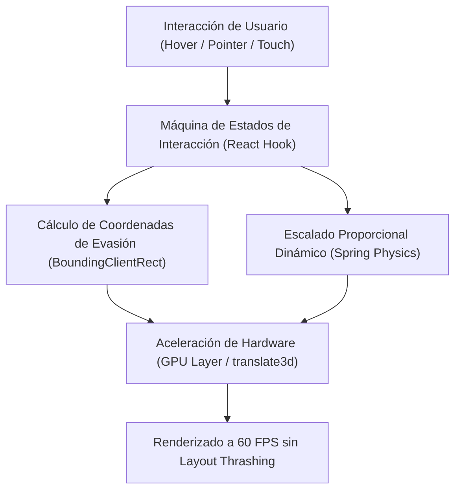

# ⚡ Interactive Canvas Studio — Micro-Interactions & Motion Physics in React

[](https://react.dev/)
[](https://developer.mozilla.org/)
[](https://www.w3.org/Style/CSS/)
[](https://www.netlify.com/)
[](LICENSE)

Vitrinas de ingeniería frontend y micro-interacciones declarativas construida en **React 19**. Implementa máquinas de estado discretas para físicas de evasión dinámica en pantalla, animaciones fluidas a 60 FPS aceleradas por hardware (GPU `transform: translate3d`) y gestión de eventos touch/mouse responsiva para interfaces interactivas.

---

## 🏛️ Arquitectura de Componentes & Físicas de Interacción



---

## ⚡ Principios de Ingeniería Frontend Demostrados

1. **Prevención de Layout Thrashing:** Las transformaciones geométricas se delegan exclusivamente a `transform` y `opacity`, garantizando que el navegador ejecute únicamente la fase de *Compositing* en la GPU sin provocar reflujos forzados (*reflow*).
2. **Máquina de Estados Reactiva:** Modelado explícito de transiciones de interfaz mediante hooks declarativos (`useState`, `useCallback`, `useMemo`), evitando efectos colaterales desordenados.
3. **Diseño Líquido & Touch Friendly:** Adaptación milimétrica para pantallas móviles con áreas de toque táctiles $\ge 44 \times 44\text{ px}$ según estándares de accesibilidad WCAG.

---

## 📂 Estructura del Código

```
interactive-canvas-studio/
├── proyecto-react/
│   ├── src/
│   │   ├── App.jsx                   # Máquina de estados principal y orquestador
│   │   ├── components/               # Componentes modulares reutilizables
│   │   └── styles/                   # Keyframes CSS y reglas de aceleración GPU
│   ├── public/                       # Assets optimizados
│   └── package.json                  # Dependencias de React y scripts de bundling
├── carta-luyuromo.jsx                # Componente autocontenido de referencia
└── README.md                         # Documentación de ingeniería
```

---

## 🚀 Instalación y Ejecución Local

### Requisitos
- **Node.js 18+** o superior.
- Gestor de paquetes `npm` o `pnpm`.

### 1. Clonar el Repositorio
```bash
git clone https://github.com/frankitoromas-tech/interactive-canvas-studio.git
cd interactive-canvas-studio/proyecto-react
```

### 2. Instalar Dependencias
```bash
npm install
```

### 3. Iniciar el Servidor de Desarrollo
```bash
npm start
```
La aplicación se abrirá en `http://localhost:3000`.

### 4. Compilar para Producción
```bash
npm run build
```

---

## 👨‍💻 Autor & Contacto
- **Desarrollador:** **Frankosyni (Φρανκοσύνη/Francus.)** 🔥 — Frank Emiliano Vargas Huamán
- **Especialidad:** Software & Agentic AI Developer | Frontend & Backend Architecture
- **GitHub:** [@frankitoromas-tech](https://github.com/frankitoromas-tech)
- **LinkedIn:** [Frankosyni en LinkedIn](https://linkedin.com/in/frankosyni-undefined-6a010a378/)
- **Licencia:** [MIT](LICENSE)
